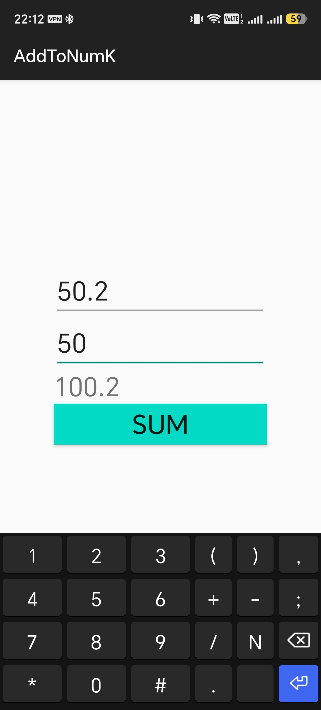

# Приложение для сложения двух чисел 

## Решение


## Задача
Доработайте [приложение для сложения двух чисел](https://github.com/ipetrushin/AddToNumK)
```kotlin
// TODO: 1) реализовать проверку на пустые значения в полях numA, numB
// TODO: 2) исправить разметку, чтобы можно было вводить только числа
// TODO: 3) сделать поддержку вещественных (не целых чисел)
```
В качестве ответа приложите исходный код XML, Kotlin и демонстрацию работы (должно быть понятно, что реализованные функции работают)
